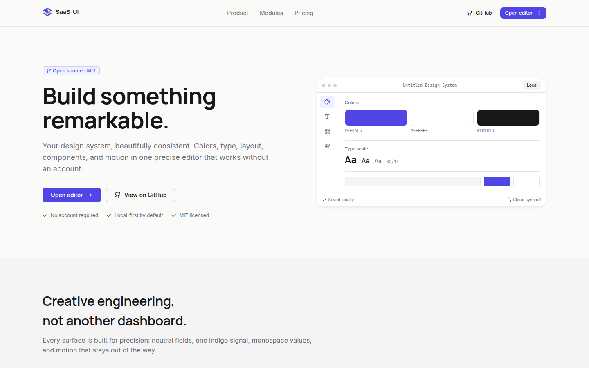
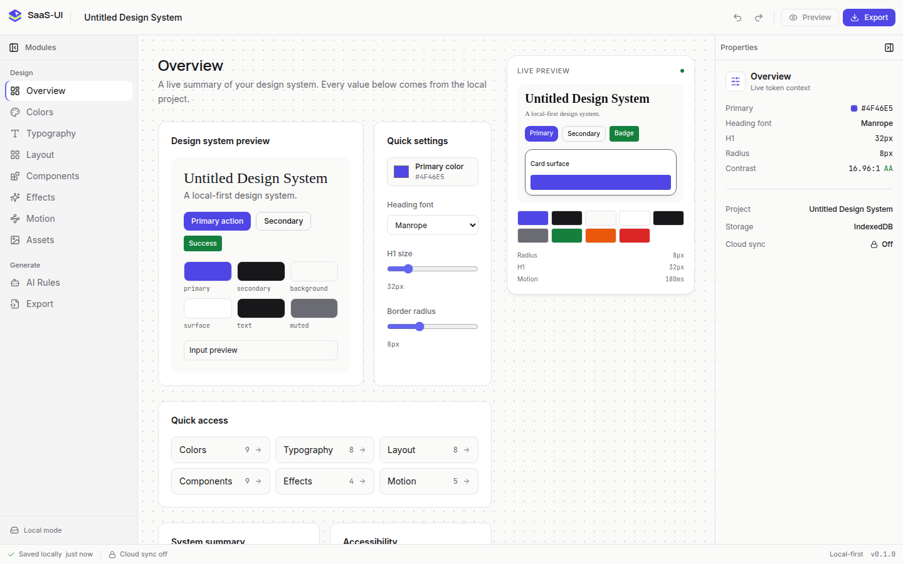

<p align="left">
  
</p>

# SaaS-UI

> A local-first visual editor for design systems. No account. No server. No lost work.

[](https://react.dev)
[](https://www.typescriptlang.org)
[](https://vitejs.dev)
[](https://nodejs.org)
[](LICENSE)
[](https://github.com/BlackBenAI/saas-ui)

[](docs/assets/saas-ui-demo.webm)

SaaS-UI is the MIT-licensed, local-first editor for design tokens. It runs entirely in your
browser, stores projects in IndexedDB, and never asks for an account. The design system is the
source of truth: colors, type, layout, components, effects, and motion stay in one place instead
of drifting between a canvas, a stylesheet, and a codebase.

The open-source build is the foundation. The hosted edition adds the cloud, collaboration, and
administrative layers on top of the same local editor.

## Demo

- **[Watch the short product demo](docs/assets/saas-ui-demo.webm)** — a real local session:
  open the editor, rename the project, collapse panels, undo/redo, reload, and recover the work.
- [Landing page](docs/assets/landing.png)
- [Editor shell](docs/assets/editor-overview.png)
- [Project restored after reload](docs/assets/editor-persisted.png)

The screenshots and video are captured from the running application with Playwright, not
mockups. Regenerate them with `npm run capture:demo` while the dev server is running.

## Why SaaS-UI

- **Local first** — IndexedDB autosave with no account, API, or network dependency.
- **Exact values** — the same token model feeds the UI, preview, and exports.
- **Creative engineering** — Linear/Figma/Raycast-grade precision, restrained motion, no
  dashboard clutter.
- **Open source** — MIT-licensed editor, transparent core, and a public roadmap.
- **Honest scope** — all ten modules and five export formats work locally in this build.

## Current status

| Area | Status |
|---|---|
| Local editor shell | Available |
| Project name, undo/redo, panel collapse | Available |
| Local project hub, create/open/duplicate/delete | Available |
| Automatic project creation when none exists | Available |
| IndexedDB autosave and reload persistence | Available |
| Overview module | Available |
| Colors, Typography, Layout, Components, Effects, Motion, Assets, AI Rules, Export | Available |
| CSS, Tailwind, TypeScript, JSON, Markdown exports | Available |
| Figma variables export and import | Available |
| Vite + Next.js/shadcn starter handoff | Available |
| Responsive editor shell | Available |
| Accounts, cloud sync, collaboration, billing, community | Proprietary hosted service, maintained separately |

Every module edits the same local design system. Exports are generated in the browser and never
require an account, API, or server. There are no fake metrics, fake testimonials, or decorative
buttons in the product.

## What works today

- Open `/dashboard` with no account and no API; it is the hub for all editor modules.
- `/projects` lists local projects and lets you create, open, duplicate, or delete them. A
  project is created automatically when none exists.
- Rename the project; the value is saved locally and survives a reload.
- Edit colors, typography, layout, components, effects, motion, assets, and AI rules.
- Collapse and expand the module sidebar and the properties panel.
- Undo and redo changes with a 50-entry local history.
- See autosave status in the footer: saving, saved locally, unsaved, or error.
- Export CSS variables, Tailwind, TypeScript, JSON, and Markdown from the browser.
- Download a complete `AI_INTERFACE_BRIEF.md` from the AI Rules module for coding agents.
- Generate a Vite + React or Next.js + shadcn starter with a real token-driven page from Export.
- Preview the generated starter live, download it as files or a Markdown bundle, and round-trip the tokens through a Figma variables JSON file.
- On narrow screens, use the horizontal module bar; side panels collapse out of the way.
- Inspect the project name, storage backend, contrast, and cloud state in the properties panel.

## Screenshots

### Editor shell



### The project is still there after a reload


## Documentation

- The canonical documentation lives in this repository: `README.md`, `PRODUCT.md`, `DESIGN.md`, and `OPEN_CORE.md`.
- The wiki source lives in [`docs/wiki/`](docs/wiki/). Enable **Wikis** in the repository settings, create the first `Home` page, then run `bash docs/wiki/publish-wiki.sh`.
- The wiki covers onboarding, architecture, local-first data, design principles, contributing, roadmap, FAQ, and security.

## Quick start

Requires Node.js 20+ and npm.

```bash
cd frontend
npm install
npm run dev
```

Open `http://localhost:5173`.

With Docker:

```bash
docker compose up --build
```

Open `http://localhost:3000`. Set `FRONTEND_PORT` to use another host port.

Set `VITE_REPOSITORY_URL` in `frontend/.env.local` to override the GitHub link shown in the UI.

## Commands

| Command | Purpose |
|---|---|
| `make install` | Install frontend dependencies |
| `make dev` | Start the Vite dev server |
| `make build` | Type-check and build the production bundle |
| `make preview` | Preview the production build |
| `make test` | Run the Vitest suite |
| `make lint` | Run ESLint with zero warnings |
| `make typecheck` | Run `tsc --noEmit` |
| `make up` | Build and start the frontend container |
| `make down` | Stop the container |
| `make logs` | Follow container logs |

From `frontend/`, you can also run the underlying scripts directly:

```bash
npm run dev
npm run build
npm run preview
npm run test -- --run
npm run lint
npm run typecheck
npm run capture:demo
```

`capture:demo` requires the dev server at `http://127.0.0.1:5173` and writes the screenshots
and WebM video to `docs/assets/`.

## How it works

```text
Browser
  React 18 + Vite + TypeScript
  ├─ Zustand store        design system, history, save status
  ├─ localStorage         fast hydration for preferences and the current system
  ├─ Dexie / IndexedDB    project records, the durable local source
  ├─ Editor shell         56px header, collapsible sidebar, canvas, properties, footer
  └─ Landing page         product overview and editor entry point
```

The local flow:

1. `/dashboard` hydrates the Zustand store from localStorage.
2. `EditorPage` loads the most recently updated project from IndexedDB.
3. Every edit updates the store immediately and marks the project unsaved.
4. `useAutosave` writes the project to IndexedDB after a 700 ms debounce.
5. Reloading restores the latest project from IndexedDB; the work is never gated by a server.

The editor has no API client, authentication, or cloud dependency. That boundary is deliberate:
the local editor must remain usable offline, and the cloud must stay an explicit upgrade.

## Design principles

- Zinc-dominant surfaces, one indigo action color, and no decorative gradients.
- Manrope for display, Inter for UI, JetBrains Mono for values.
- Borders before shadows; shadows only for floating layers.
- Lucide icons only; no emoji as UI icons.
- 100–200 ms motion, with `prefers-reduced-motion` respected.
- Real content and real controls; no invented statistics or fake product claims.

The full visual system lives in [PRODUCT.md](PRODUCT.md) and [DESIGN.md](DESIGN.md).

## Testing and quality

```bash
cd frontend
npm run typecheck
npm run lint
npm run test -- --run
npm run build
```

The Vitest suite covers the landing page, all ten editor modules, project management, exports,
handoff starters, Figma round-trips, AI brief generation, and IndexedDB persistence. The build
runs TypeScript in strict mode before Vite produces the production bundle.

## Open-core boundary

This repository is the open-source editor:

- React/Vite editor shell, design-system model, tokens, and local state.
- IndexedDB persistence, autosave, local project loading, and shared UI components.
- The landing page, design documentation, and tests.
- The editor remains fully usable without an account, a network connection, or the hosted API.

The hosted service is separate and proprietary:

- Accounts, JWT/OAuth, sessions, and MFA.
- Organizations, PostgreSQL row-level security, and audit logging.
- FedaPay subscriptions, billing, invoices, and webhooks.
- Cloud sync, shared projects, real-time collaboration, and version history.
- Community publishing, moderation, and administrative operations.
- Production deployment, infrastructure, secrets, and operational tooling.

See [OPEN_CORE.md](OPEN_CORE.md) for the contract.

## Roadmap

1. Add a plugin API for custom modules and exporters.
2. Ship a component-level preview and documentation surface.
3. Expand accessibility and keyboard-first editing coverage.
4. Add more framework starters and token importers.
5. Keep the cloud, collaboration, billing, and marketplace layers in the separate hosted service.

The roadmap is intentionally public and incremental. The open-source editor must stay useful at
every step, not only after the hosted edition is connected.

## Contributing

- Keep the local editor independent of the hosted service.
- Do not add fake metrics, fake testimonials, decorative buttons, emoji UI icons, or cloud-only
  gates.
- UI copy and code identifiers are in English.
- Run `npm run typecheck`, `npm run lint`, `npm run test -- --run`, and `npm run build` before
  opening a pull request.
- Keep generated demo assets in `docs/assets/` and regenerate them from the running app.

## Security

Do not open public issues for vulnerabilities. Report them privately to
`security@blackbenai.bj`.

## License

MIT © 2026 BlackBenAI. See [LICENSE](LICENSE).
