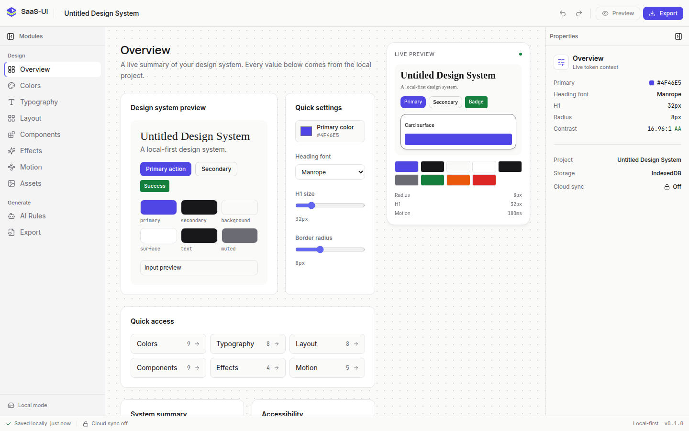

# Documentación de SaaS-UI

**Un editor visual local-first para design systems. Sin cuenta. Sin servidor. Sin trabajo perdido.**

SaaS-UI es el editor MIT de tokens de diseño. Funciona en el navegador, guarda los proyectos en
IndexedDB y mantiene el design system como fuente de verdad para colores, tipografía, maquetación,
componentes, efectos y movimiento.

[](https://github.com/BlackBenAI/saas-ui)

## Empieza aquí

| Guía | Contenido |
|---|---|
| [Primeros pasos](/es/guide/getting-started) | Instalación, primer proyecto, Docker, solución de problemas |
| [Arquitectura (EN)](/guide/architecture) | Shell, estado, persistencia, rutas, puntos de extensión |
| [Datos locales (EN)](/guide/local-first-data) | IndexedDB, localStorage, autoguardado, migración |
| [Principios de diseño (EN)](/guide/design-principles) | Tokens, tipografía, color, movimiento, accesibilidad |
| [Contribuir (EN)](/guide/contributing) | Instalación, comprobaciones, expectativas de PR, alcance |
| [Hoja de ruta (EN)](/guide/roadmap) | Estado actual, próximos hitos, frontera open-core |
| [FAQ (EN)](/guide/faq) | Cuentas, nube, exportación, móvil, datos, licencia |
| [Seguridad (EN)](/guide/security) | Reporte, datos locales, secretos, dependencias |

## Estado actual

La versión open source es una base honesta y deliberadamente limitada:

- El shell del editor, el nombre del proyecto, deshacer/rehacer, el plegado de paneles y los diez módulos son interactivos.
- El autoguardado en IndexedDB y la restauración tras recargar funcionan sin cuenta ni API.
- Las exportaciones CSS, Tailwind, TypeScript, JSON y Markdown se ejecutan localmente en el navegador.
- El shell es responsive, con barra de módulos en móvil.
- La nube, la colaboración, la facturación y la comunidad pertenecen al servicio alojado separado.

Sin métricas falsas, testimonios falsos, botones decorativos ni bloqueos cloud-only.

## Inicio rápido

```bash
cd frontend
npm install
npm run dev
```

Abre `http://localhost:5173`.

Con Docker:

```bash
docker compose up --build
```

Abre `http://localhost:3000`. Usa `FRONTEND_PORT` para cambiar el puerto del host.

## Demo

- [Ver la demo de 33 segundos](https://github.com/BlackBenAI/saas-ui/raw/main/docs/assets/saas-ui-demo.webm)
- [Captura de la landing](https://raw.githubusercontent.com/BlackBenAI/saas-ui/main/docs/assets/landing.png)
- [Editor tras recargar](https://raw.githubusercontent.com/BlackBenAI/saas-ui/main/docs/assets/editor-persisted.png)

## Repositorio

- [Código fuente](https://github.com/BlackBenAI/saas-ui)
- [README](https://github.com/BlackBenAI/saas-ui/blob/main/README.md)
- [Frontera open-core](https://github.com/BlackBenAI/saas-ui/blob/main/OPEN_CORE.md)
- [Issues](https://github.com/BlackBenAI/saas-ui/issues)

> Las páginas marcadas **(EN)** aún no están traducidas. Consulta
> [`docs/I18N.md`](https://github.com/BlackBenAI/saas-ui/blob/main/docs/I18N.md) para la regla de
> traducción y el estado actual.
