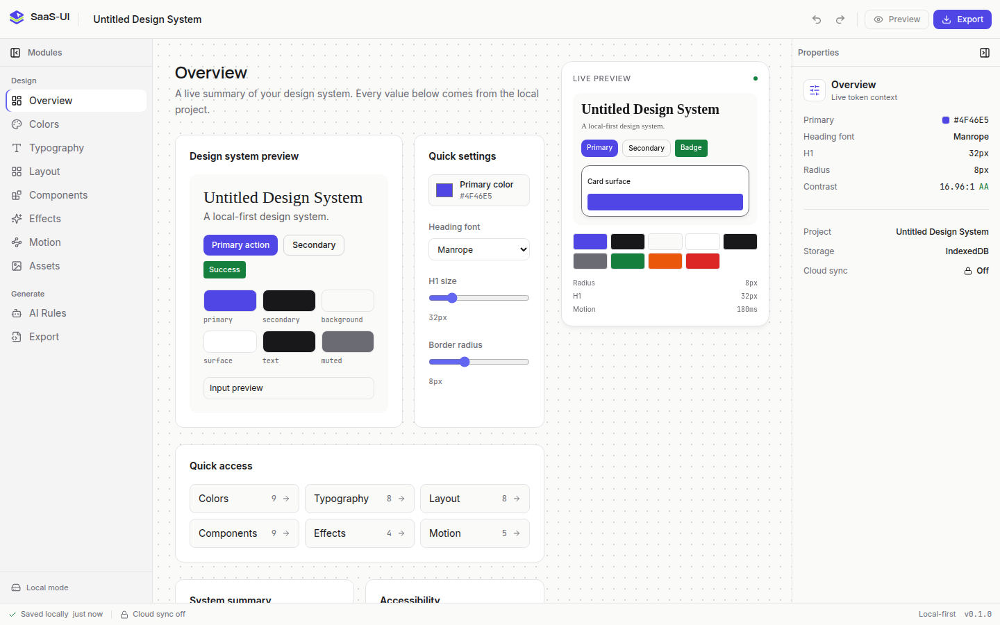

# Documentation SaaS-UI

**Un éditeur visuel local-first pour les design systems. Sans compte. Sans serveur. Sans travail perdu.**

SaaS-UI est l’éditeur MIT de tokens de design. Il fonctionne dans le navigateur, stocke les
projets dans IndexedDB et garde le design system comme source de vérité pour les couleurs, la
typographie, la mise en page, les composants, les effets et le mouvement.

[](https://github.com/BlackBenAI/saas-ui)

## Commencer ici

| Guide | Contenu |
|---|---|
| [Démarrage rapide](/fr/guide/getting-started) | Installation, premier projet, Docker, dépannage |
| [Architecture (EN)](/guide/architecture) | Shell, état, persistance, routage, points d’extension |
| [Données locales (EN)](/guide/local-first-data) | IndexedDB, localStorage, sauvegarde automatique, migration |
| [Principes de design (EN)](/guide/design-principles) | Tokens, typographie, couleur, mouvement, accessibilité |
| [Contribuer (EN)](/guide/contributing) | Installation, contrôles, attentes de PR, périmètre |
| [Feuille de route (EN)](/guide/roadmap) | État actuel, prochaines étapes, frontière open-core |
| [FAQ (EN)](/guide/faq) | Comptes, cloud, export, mobile, données, licence |
| [Sécurité (EN)](/guide/security) | Signalement, données locales, secrets, dépendances |

## État actuel

La version open source est une base honnête et volontairement limitée :

- Le shell de l’éditeur, le nommage de projet, annuler/rétablir, le repli des panneaux et les dix modules sont interactifs.
- La sauvegarde IndexedDB et la restauration après rechargement fonctionnent sans compte ni API.
- Les exports CSS, Tailwind, TypeScript, JSON et Markdown s’exécutent localement dans le navigateur.
- Le shell est responsive, avec une barre de modules sur mobile.
- Le cloud, la collaboration, la facturation et la communauté appartiennent au service hébergé séparé.

Aucune fausse métrique, aucun faux témoignage, aucun bouton décoratif, aucun verrou cloud-only.

## Démarrage

```bash
cd frontend
npm install
npm run dev
```

Ouvrez `http://localhost:5173`.

Avec Docker :

```bash
docker compose up --build
```

Ouvrez `http://localhost:3000`. Utilisez `FRONTEND_PORT` pour changer le port hôte.

## Démo

- [Voir la démo de 33 secondes](https://github.com/BlackBenAI/saas-ui/raw/main/docs/assets/saas-ui-demo.webm)
- [Capture de la landing](https://raw.githubusercontent.com/BlackBenAI/saas-ui/main/docs/assets/landing.png)
- [Éditeur après rechargement](https://raw.githubusercontent.com/BlackBenAI/saas-ui/main/docs/assets/editor-persisted.png)

## Dépôt

- [Code source](https://github.com/BlackBenAI/saas-ui)
- [README](https://github.com/BlackBenAI/saas-ui/blob/main/README.md)
- [Frontière open-core](https://github.com/BlackBenAI/saas-ui/blob/main/OPEN_CORE.md)
- [Issues](https://github.com/BlackBenAI/saas-ui/issues)

> Les pages marquées **(EN)** ne sont pas encore traduites. Voir
> [`docs/I18N.md`](https://github.com/BlackBenAI/saas-ui/blob/main/docs/I18N.md) pour la règle de
> traduction et l’état d’avancement.
