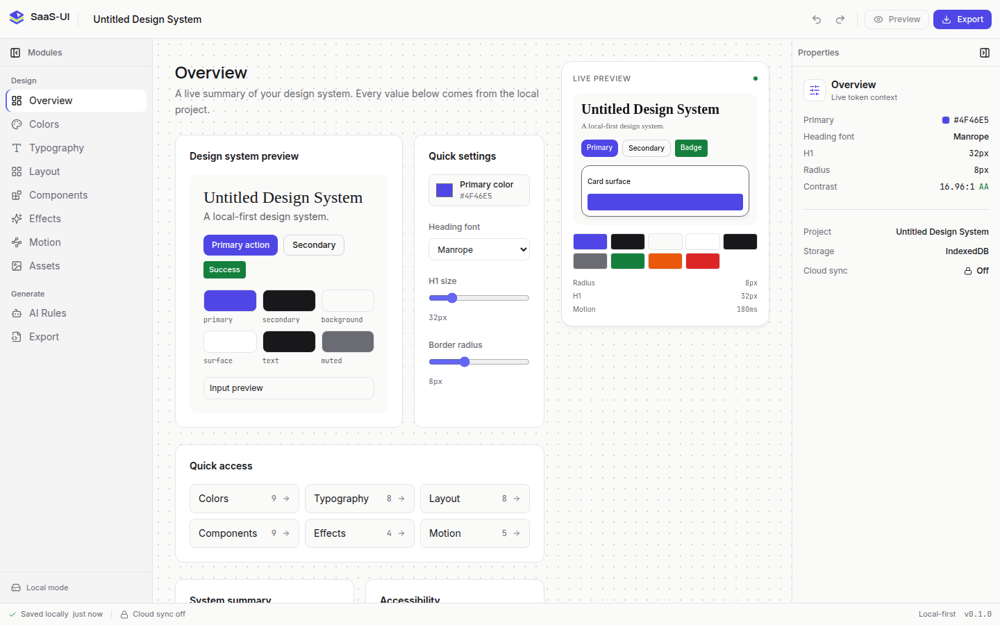

# SaaS-UI Wiki

**A local-first visual editor for design systems. No account. No server. No lost work.**

SaaS-UI is the MIT-licensed editor for design tokens. It runs in the browser, stores projects
in IndexedDB, and keeps the design system as the source of truth for colors, type, layout,
components, effects, and motion.

[](https://github.com/BlackBenAI/saas-ui)

## Start here

| Guide | What it covers |
|---|---|
| [Getting Started](Getting-Started) | Install, run, first project, Docker, troubleshooting |
| [Architecture](Architecture) | Shell, state, persistence, routing, extension points |
| [Local-First Data](Local-First-Data) | IndexedDB, localStorage, autosave, migration, reset |
| [Design Principles](Design-Principles) | Tokens, typography, color, motion, accessibility |
| [Contributing](Contributing) | Setup, checks, PR expectations, scope boundaries |
| [Roadmap](Roadmap) | Current status, next milestones, open-core boundary |
| [FAQ](FAQ) | Accounts, cloud, export, mobile, data, licensing |
| [Security](Security) | Reporting, local data, secrets, dependency hygiene |

## Current status

The open-source build is an early, honest foundation:

- The editor shell, project naming, undo/redo, panel collapse, and all ten modules are interactive.
- IndexedDB autosave and reload persistence work without an account or API.
- CSS, Tailwind, TypeScript, JSON, and Markdown exports run locally in the browser.
- The editor has a responsive shell with a mobile module bar.
- Cloud sync, collaboration, billing, and community belong to the separate hosted service.

There are no fake metrics, fake testimonials, decorative buttons, or cloud-only gates.

## Quick start

```bash
cd frontend
npm install
npm run dev
```

Open `http://localhost:5173`.

With Docker:

```bash
docker compose up --build
```

Open `http://localhost:3000`. Set `FRONTEND_PORT` to use another host port.

## Demo

- [Watch the 33-second demo](https://github.com/BlackBenAI/saas-ui/raw/main/docs/assets/saas-ui-demo.webm)
- [Landing page screenshot](https://raw.githubusercontent.com/BlackBenAI/saas-ui/main/docs/assets/landing.png)
- [Editor after reload](https://raw.githubusercontent.com/BlackBenAI/saas-ui/main/docs/assets/editor-persisted.png)

## Repository

- [Source code](https://github.com/BlackBenAI/saas-ui)
- [README](https://github.com/BlackBenAI/saas-ui/blob/main/README.md)
- [Open-core boundary](https://github.com/BlackBenAI/saas-ui/blob/main/OPEN_CORE.md)
- [Issues](https://github.com/BlackBenAI/saas-ui/issues)

The canonical documentation lives in the repository. This wiki is the onboarding and
community-facing companion to it.
